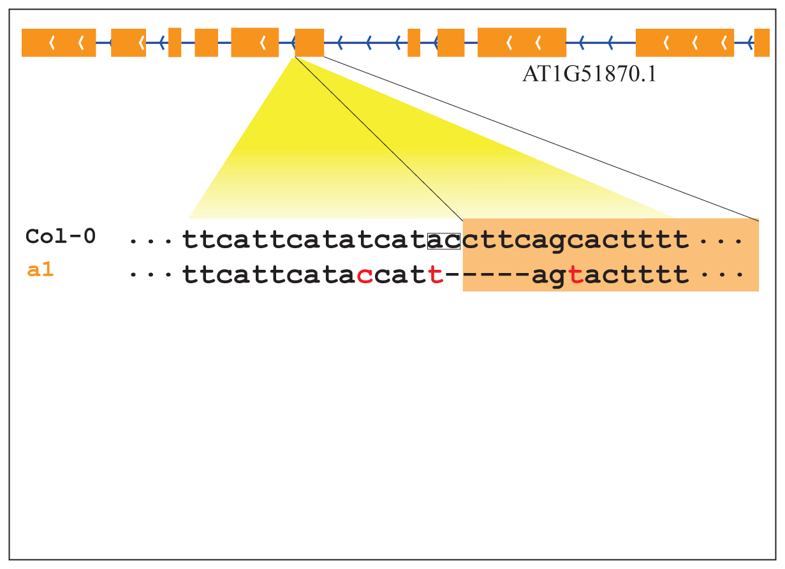

# GEAN &middot; [![license][license-badge]][license]

Variation in gene sequences and genomic features among individuals is central to research on natural variation. Reference genome sequences and their genomic features, typically annotated in GFF or GTF format, are often well established, while the genomes of other accessions or lines are increasingly being sequenced.

However, there is no well-established solution for transferring genomic feature annotations from a reference accession or line to other individuals. GEAN transfers reference annotations to individuals whose genome sequences are available from whole-genome resequencing or *de novo* assembly. It addresses the [inconsistent alignment problem](https://journals.plos.org/plosgenetics/article?id=10.1371/journal.pgen.1007699), which can produce false-positive splice-site disruptions or erroneous ORF-shift predictions. GEAN also supports whole-genome multiple sequence alignment (MSA) guided by genomic features.

GEAN can also transfer well-curated genomic feature annotations from a model species to a closely related species with a newly sequenced genome.

<p align="center">

</p>
GEAN addresses this problem with a dynamic programming algorithm called Zebric stripped dynamic programming (ZDP).

This pipeline supports analyses in which gene-structure annotations across accessions are important, including studying natural variation in a gene of interest, quantifying gene expression in non-reference accessions or lines, and detecting differential expression among accessions or lines.

Using gene annotations as anchors, GEAN can perform genome-wide sequence alignment at base-pair resolution and call variants.

## Installation

### Dependencies

- A CPU with AVX2 support
- GNU GCC 6.0 or later
- CMake 3.0 or later

```
git clone https://github.com/baoxingsong/GEAN.git
cd GEAN
cmake CMakeLists.txt
make
```

These commands generate an executable named `gean`.
<!--
## Run it
````
Program gean
Usage: gean <command> [options]
Commands:
 -- variant calling:
    pseudogeno  create a pseudogenome sequence
    lift        transform a coordinate to another accession
    revlift     transform a coordinate from another accession to the reference
    liftgff     transform all GFF/GTF coordinates
    revliftgff  transform all GFF/GTF coordinates back to the reference
    reanva      update variant records for functional annotation
    gff2seq     extract protein/CDS/gene sequences from a GFF/GTF file
    annowgr     annotate a resequenced genome
    randomVar   assign a random position to each variant
 -- genome-wide MSA:
    premsa      split whole-genome sequences into fragments
    msatosdi    generate SDI files from MSA results

 -- de novo genome assembly:
    transgff    transfer a reference GFF/GTF annotation to a de novo assembly
    purifygff   remove duplicate annotations from transgff output
````

#### pseudogeno
Generate a pseudogenome sequence for a resequenced accession or line from a reference genome and variant records.
````
Usage: gean pseudogeno -r reference -v variants -o output
Options
 -h         show this help message
 -r FILE    reference genome in FASTA format
 -v FILE    variant-calling result in VCF/SDI format
 -p STRING  prefix for VCF records
 -o FILE    output pseudogenome in FASTA format
````
The `-prefix` option specifies the chromosome-name prefix used in VCF/SDI variant records. For example, chromosomes in the TAIR10 reference genome are named Chr1, Chr2, Chr3, Chr4, and Chr5, whereas chromosomes in VCF files from the 1001 Genomes Project are named 1, 2, 3, 4, and 5. Set `-prefix Chr` to reconcile these naming conventions. If the prefix is incorrect, the software will behave as though the input VCF/SDI file contains no variant records.

#### lift
Lift a coordinate from the reference genome to the pseudogenome of a resequenced accession or line.
````
Usage: gean lift -v variants -c chromosome -p position
Options
 -h         show this help message
 -r FILE    reference genome in FASTA format
 -v FILE    variant-calling result in VCF/SDI format
 -f STRING  prefix for VCF records
 -c STRING  chromosome
 -p INT     position/coordinate in the reference genome
````

#### revlift
Lift a coordinate from the pseudogenome of a resequenced accession or line back to the reference genome.
````
Usage: gean revlift -v variants -c chromosome -p position
Options
 -h         show this help message
 -r FILE    reference genome in FASTA format
 -v FILE    variant-calling result in VCF/SDI format
 -f STRING  prefix for VCF records
 -c STRING  chromosome; must match the chromosome name in the SDI file (coordinates are 1-based)
 -p INT     position/coordinate in the resequenced genome
````

#### liftgff
Infer gene-structure annotations for a resequenced accession or line by coordinate liftover alone.
````
Usage: gean liftgff -v variants -i inputGffFile -o outputGffFile
Options
 -h         show this help message
 -r FILE    reference genome in FASTA format
 -v FILE    variant-calling result in VCF/SDI format
 -i FILE    input GFF/GTF file for the reference accession or line
 -f STRING  prefix for VCF records
 -o         output GFF/GTF file for the target accession or line
````

#### revliftgff
Lift gene-structure annotations from a resequenced accession or line back to the reference genome by coordinate liftover alone.
````
Usage: gean revliftgff -v variants -i inputGffFile -o outputGffFile
Options
 -h         show this help message
 -r FILE    reference genome in FASTA format
 -v FILE    variant-calling result in VCF/SDI format
 -i FILE    input GFF/GTF file for the non-reference accession or line
 -f STRING  prefix for VCF records
 -o         output GFF/GTF file for the reference accession or line
````

#### reanva
Realign sequences with the ZDP algorithm to resolve inconsistent INDEL alignments and recover variants that could otherwise produce false-positive ORF-shift predictions.
````
Usage: gean reanva -i inputGffFile -r inputGenome -a similar segments -s new genome sequence -o output GFF/GTF file
Options
 -h        show this help message
 -i FILE   GFF/GTF file
 -r FILE   reference genome sequence
 -v FILE   variant-calling result in VCF/SDI format
 -f STRING prefix for VCF records
 -o FILE   output file
 -m INT    minimum intron size
 ````
 * The software evaluates ORF states using the following criteria:
     1) Splice sites match a motif in the `SpliceSites` file included with the release.
     2) Introns meet the specified minimum length.
     3) CDS sequences meet the specified minimum length.
     4) CDS sequence lengths are divisible by 3.
     5) CDS sequences contain no premature stop codons.
     6) CDS sequences end with a stop codon.
     7) CDS sequences begin with a start codon.

   IUPAC ambiguity codes in DNA sequences are supported. ORF-state results are included with the CDS output.

#### gff2seq
Extract CDS, genomic transcript, and protein sequences for each protein-coding transcript, and evaluate its protein-coding potential (referred to as its ORF state). CDS attributes may use GFF3 `Parent` syntax, including multiple parents, or GTF `transcript_id` syntax.
````
Usage: gean gff2seq -i inputGffFile -r inputGenome [-p outputProteinSequences] [-c outputCdsSequences] [-g outputGenomeSequences] [-a] [-n INT]
Options
 -h        show this help message
 -i FILE   reference genome in GFF/GTF format
 -r FILE   genome sequence in FASTA format
 -m INT    minimum intron size for ORF-state checking
 -a, --auto-adjust    automatically adjust transcript ends based on ORF states (default false)
 -n, --orf-count INT  number of ORFs used for automatic adjustment (default 100)
 -p FILE   output protein sequences in FASTA format
 -c FILE   output CDS sequences (without introns) in FASTA format
 -g FILE   output transcript sequences (with introns) in FASTA format
           at least one of -p, -c, or -g is required; any combination is allowed
````

#### annowgr
Transfer reference gene-structure annotations to resequenced accessions or lines using several complementary methods.
````
Usage: gean annowgr -i inputGffFile -r referenceGenomeSequence -v variants -o outputGffFile
Options
 -h        show this help message
 -i FILE   reference GFF/GTF file
 -n FILE   de novo GFF annotation for the target accession
 -r FILE   reference genome in FASTA format
 -v FILE   variant-calling result in VCF/SDI format
 -o FILE   output GFF/GTF file
 -m INT    minimum intron size
 -d        remove reference transcripts with ORF shifts (default: false)
 -f STRING prefix for VCF records
 -t INT    number of threads (default: 4)
 -l INT    maximum transcript length to align (default: 50000)
````


#### randomVar
Assign a random position to each variant in a variant-calling result file. The output can be used to compare observed variants with randomly positioned variants.
````
Usage: gean randomVar -v variants
Options
   -h        show this help message
   -r        (string) reference genome in FASTA format
   -v        variant-calling result in VCF/SDI format
   -o        output-file prefix
````


### Genome-wide multiple sequence alignment pipeline (under testing)
#### premsa
Split the genome sequences of a population into fragments for multiple sequence alignment.
````
Usage: gean premsa -i inputGffFile -r referenceGenomeSequence -v variants
Options
 -h         show this help message
 -i FILE    input GFF/GTF file for the reference accession or line
 -r FILE    reference genome
 -v FILE    list of variant-calling result files
 -f STRING  prefix for VCF records
 -m INT     minimum intron size
 -t INT     number of threads (default: 4)
 -w INT     window size (default: 10000)
 -s INT     window overlap size (default: 500)
 -p INT     output cache size (default: 100)
 -l INT     maximum transcript length to align (default: 50000)
````

#### msatosdi
Call variants from multiple sequence alignments of genome fragments from a population.
````
Usage: gean msatosdi -i inputGffFile -r referenceGenomeSequence -v variants -o outputGffFile
Options
 -h         show this help message
 -a FILE    accession list
 -c FILE    chromosome list
 -m FOLDER  folder containing MSA results
 -o FOLDER  output folder
 -r FILE    reference genome in FASTA format
 -t INT     number of threads (default: 4)
 -v FILE    list of variant-calling result files
 -f STRING  prefix for VCF records
 ````
 
### Pipeline for transferring reference gene-structure annotations to a closely related de novo assembly
#### transgff
Transfer reference gene-structure annotations to a *de novo* genome assembly based on whole-genome sequence alignment.
The output may contain duplicate gene-annotation records that are incompatible with other software. Use the following command to remove them.
````
Usage: gean transgff -i inputGffFile -r inputGenome -a similar segments -s new genome sequence -o output GFF/GTF file
Options
 -h        show this help message
 -i FILE   reference GFF/GTF file
 -r FILE   reference genome sequence
 -a FILE   similar sequence segments
 -s FILE   target genome sequence
 -o FILE   output GFF/GTF file
 -w INT    sequence alignment window width (default: 60)
 -l        run in slow mode (default: false)
 -m INT    minimum intron size
 ````
 
#### purifygff
Remove duplicate gene-structure annotations generated by `transgff`.
````
 Usage: gean purifygff -i inputGffFile -s inputGenome -o output GFF/GTF file
 Options
  -h        show this help message
  -i FILE   GFF/GTF file
  -s FILE   target genome sequence
  -o FILE   output GFF/GTF file
  -x INT    minimum gene length
  -m INT    minimum intron size
````
-->
Several functions included in the source code are still under testing. Documentation for these functions will be released after testing is complete.

Best-practice workflows for different goals are available in the `example` directory.

### Manual

[GEAN manual](gean-manual.pdf)

### Examples

- [Genome-wide pairwise sequence alignment and variant calling for a de novo assembly](example/denovoVariantCalling/README.md)
- [Genome-wide multiple sequence alignment using variant-calling results](example/variantsSynchronization/README.md)
- [Transfer a maize reference-genome annotation to a de novo assembly](example/transformMaizeGFFannotation.md)

### Support Us

Please support GEAN by citing it in your publications.

### Contact

For bug reports, questions, suggestions, feature requests, or collaboration inquiries, please email songbaoxing168@163.com.

### Citing GEAN

If you use GEAN, please cite: <br />
`
Song B, Sang Q, Wang H, Pei H, Gan X and Wang F. Complement Genome Annotation Lift Over Using a Weighted Sequence Alignment Strategy. Front. Genet. 10:1046. doi: 10.3389/fgene.2019.01046
`
### Acknowledgments

We thank [Professor Björn Usadel](http://www.usadellab.org/) for valuable suggestions on improving performance.

We thank Dr. Hequan Sun of MPIPZ for helpful discussions.

We thank Lukas Baumgarten of MPIPZ and Qiushi Li of the University of Calgary for reporting bugs.

We thank Elad Oren of the Hebrew University of Jerusalem for extending the use cases of GEAN.

### Funding

NSFC: 31900486

[license]: ./LICENSE
[license-badge]: https://img.shields.io/badge/license-MIT-blue.svg
